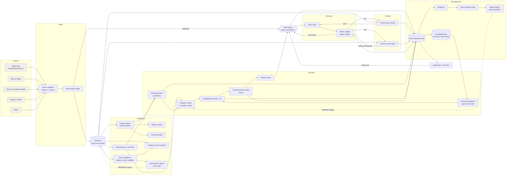

# mybot — Architecture & Technical Specification

> **What this is.** A real-time intraday market-intelligence and trading system. It continuously gathers
> information, forms falsifiable trade hypotheses, argues against them, prices them after costs, sizes
> them under hard limits, manages open positions with a living thesis, and records every decision so it
> can be audited and learned from.
>
> **What this is not.** It is not a machine that predicts stocks. Nothing in this repository has
> demonstrated a real-world, after-cost edge. The system is designed to make it *hard to fool yourself*
> and *hard to lose a lot of money quickly*. It is not designed to make money automatically. Treat every
> claim of edge, including any you produce with this code, as false until it survives the validation
> ladder in section K.

Status legend used throughout: **[IMPL]** implemented and tested in this repo · **[IFACE]** interface or adapter
present, needs a paid data source or credentials · **[PLAN]** specified here, not built yet.

Evidence legend: **E1** established (replicated, survives costs) · **E2** promising (some peer-reviewed or
serious practitioner evidence, contested or decaying) · **E3** speculative · **E4** unsupported or refuted.

---

## Contents
A. [System architecture](#a-system-architecture) · B. [Technology stack](#b-technology-stack) ·
C. [Data-source matrix](#c-data-source-matrix) · D. [Database architecture](#d-database-architecture) ·
E. [Event architecture](#e-event-architecture) · F. [AI architecture](#f-ai-architecture) ·
G. [Indicator / feature architecture](#g-indicator--feature-architecture) · H. [Research architecture](#h-research-architecture) ·
I. [Trading architecture](#i-trading-architecture) · J. [Dynamic risk architecture](#j-dynamic-risk-architecture) ·
K. [Backtesting architecture](#k-backtesting-architecture) · L. [Learning architecture](#l-learning-architecture) ·
M. [Failure architecture](#m-failure-architecture) · N. [Security architecture](#n-security-architecture) ·
O. [Dashboard](#o-dashboard) · P. [Roadmap](#p-development-roadmap) · Q. [MVP vs production](#q-mvp-vs-production) ·
R. [Infrastructure estimates](#r-infrastructure-estimates) · S. [Testing framework](#s-testing-framework) ·
T. [20 biggest weaknesses](#t-the-20-biggest-ways-this-fails) · U. [Selling it: legal & licensing](#u-selling-it-legal-licensing-and-product) ·
V. [Research evidence review](#v-research-evidence-review)

---

## A. System architecture



### How the 40 requested engines map to code

| # | Engine | Where | Status |
|---|---|---|---|
| 1 | Market Data | `data/synthetic.py`, `data/alpaca.py` | [IMPL] synthetic · [IFACE] Alpaca IEX/SIP |
| 2 | Data Quality | `data/quality.py` | [IMPL] |
| 3 | Event streaming | `core/events.py` (in-process); Redpanda/NATS in prod | [IMPL] in-proc · [PLAN] durable log |
| 4 | Feature engineering | `features/engine.py`, `features/indicators.py` | [IMPL] |
| 5 | Technical analysis | same (trend/momentum/vol/volume/structure families) | [IMPL] subset, see G |
| 6 | Microstructure | `features/engine.py::Micro` (OFI, imbalance, microprice, spread z) | [IMPL] L1 · [PLAN] L2/L3 |
| 7 | Order flow | Lee-Ready signed volume, trade imbalance | [IMPL] |
| 8 | Options intelligence | spec in G/F | [PLAN] (needs OPRA) |
| 9 | Fundamental intelligence | used as catalyst context via news types | [PLAN] structured fundamentals |
| 10 | News intelligence | `intel/news.py` | [IMPL] lexicon + dedup + impact tracking |
| 11 | Social intelligence | spec in F | [PLAN] (weak evidence, see V) |
| 12 | Macro intelligence | `intel/catalysts.py::EventCalendar` | [IMPL] calendar · [PLAN] data feeds |
| 13 | Sector / cross-asset | relative strength vs market proxy | [IMPL] basic · [PLAN] sector ETFs, breadth |
| 14 | Regime detection | `intel/regime.py` (rules + hysteresis), `intel/hmm.py` (causal HMM) | [IMPL] |
| 15 | Catalyst detection | `intel/catalysts.py::CatalystBook` | [IMPL] |
| 16 | Anomaly detection | `intel/catalysts.py::AnomalyDetector` (robust z) | [IMPL] |
| 17 | Historical analogues | `signals/analogues.py` | [IMPL] |
| 18 | Signal generation | `signals/setups.py` | [IMPL] 4 setups |
| 19 | Signal validation | `signals/evidence.py` + gates in orchestrator | [IMPL] |
| 20 | Bull/Bear adversarial | `signals/adversarial.py` | [IMPL] |
| 21 | Probabilistic forecasting | `signals/forecast.py` | [IMPL] |
| 22 | Expected value | `signals/forecast.py` (EV and conservative EV) | [IMPL] |
| 23 | Risk | `risk/engine.py` | [IMPL] |
| 24 | Position sizing | `risk/sizing.py` | [IMPL] |
| 25 | Dynamic stop | `risk/stops.py` | [IMPL] |
| 26 | Dynamic take-profit | partials, trailing, target-2 in orchestrator | [IMPL] |
| 27 | Execution | `execution/paper.py`, `execution/alpaca.py` | [IMPL] paper · [IFACE] Alpaca |
| 28 | Portfolio exposure | risk engine caps (gross, sector, positions) | [IMPL] · [PLAN] correlation matrix |
| 29 | Position monitoring | `engine/orchestrator.py::_manage_position`, news-triggered reassessment | [IMPL] |
| 30 | Research orchestrator | `engine/orchestrator.py` | [IMPL] |
| 31 | Backtesting | `backtest/engine.py`, `backtest/walkforward.py` | [IMPL] |
| 32 | Simulation | `data/synthetic.py`, Monte Carlo | [IMPL] |
| 33 | Paper trading | `runtime.py` + PaperBroker / Alpaca paper | [IMPL] |
| 34 | Post-trade attribution | `monitoring/attribution.py` | [IMPL] |
| 35 | Model monitoring | `monitoring/drift.py` | [IMPL] |
| 36 | Drift detection | PSI + calibration + edge monitors | [IMPL] |
| 37 | Knowledge base | `audit/journal.py` (outcomes, news, trades, models) | [IMPL] SQLite · [PLAN] Postgres + vector |
| 38 | Audit / logging | hash-chained JSONL + decision index | [IMPL] |
| 39 | Dashboard | `dashboard/index.html`, `api/` | [IMPL] |
| 40 | Safety / kill switch | risk states, `/api/kill`, broker-resident stops | [IMPL] |

---

## B. Technology stack

Choices are driven by the workload. The unit of decision is a 1-minute bar or a news item, and holding
horizons are minutes to hours. **This is not an HFT system.** A retail-accessible stack
(vendor websocket → cloud VM → broker REST) has 50–500 ms end-to-end latency, and competing on
sub-second horizons at that latency is a losing game (see V.1).

| Layer | MVP (this repo) | Production | Why / why not the alternatives |
|---|---|---|---|
| Language | Python 3.11 + numpy | Python for research/orchestration; Rust or C++ only for a feed handler if L2/L3 is added | Python is fast enough at bar frequency. Measured engine latency: p50 ≈ 0.3 ms and p95 ≈ 0.7 ms per bar on one core. |
| Event bus | in-process deterministic FIFO | **Redpanda** (Kafka API, no JVM/ZooKeeper) or **NATS JetStream** | A durable log enables replay, multiple consumers and crash recovery. Kafka itself is heavier to operate than you need at this scale. |
| Time-series | in-memory + SQLite | **TimescaleDB** (Postgres) for bars/features; **Parquet on S3 + DuckDB/Polars** for tick research | Keeps one SQL engine. kdb+ is excellent but expensive and niche. ClickHouse is a good alternative at >1B rows/day. |
| Relational | SQLite | **Postgres 16** (positions, orders, limits, configs, users, model registry) | ACID for the book of record. |
| Object store | local `var/` | S3/GCS with object lock (WORM) for raw feeds, journals and model artifacts | Immutable raw data makes point-in-time replay possible. |
| Vector/search | shingle Jaccard dedup | **pgvector** inside Postgres (plus BM25 via Postgres FTS) | Avoids another database. A dedicated vector DB is justified only above tens of millions of documents. |
| ML | numpy logistic, isotonic, kNN, HMM | + LightGBM, scikit-learn, (optionally) PyTorch for sequence models | Gradient boosting is the strongest general tabular baseline. Try deep models only after it plateaus. |
| LLM | Claude via official `anthropic` SDK, optional | Same, via Batch API for backfills | Used for extraction and reasoning over text, never as the price predictor (F). |
| API/UI | FastAPI + single-file dashboard (no build step) | Same, behind a reverse proxy with SSO | Polling at 1 Hz is enough. Add websockets if you need >5 Hz. |
| Deploy | `python -m mybot` / Docker | Docker on 1–2 VMs close to the broker (us-east for US equities), systemd or Nomad/K8s | You don't need K8s for one strategy process. |
| Secrets | env vars | Cloud secret manager or HashiCorp Vault; broker keys scoped to trading only | See N. |
| Observability | journal + dashboard | + Prometheus/Grafana, Loki, pager alerts | Independent alerting path (M). |

---

## C. Data-source matrix

Prices change often. The figures were checked in September 2026 against vendor pages and
third-party reviews (sources below), so **verify before buying**. "Display" means a human looks at it;
"non-display" means an algorithm consumes it. Exchanges bill these separately, and a *sold* product that
redistributes data needs redistribution licensing (U).

### US equities: market data

| Provider | What you get | Real-time coverage | History | Approx. cost | Latency class | Watch out for |
|---|---|---|---|---|---|---|
| **Alpaca (Basic, free)** | bars, quotes, trades, news (Benzinga) via websocket/REST | **IEX only**, about 2–3% of US volume | ~2016+ | $0 | ~10–100 ms | IEX quotes are not the NBBO. Relative volume, spread and OFI computed on IEX are biased. REST is 15-min delayed for SIP. |
| **Alpaca Algo Trader Plus** | full SIP + OPRA options | consolidated | same | ~$99/mo | same | Individual, non-redistributable. The SIP is slower than direct feeds (irrelevant at minute horizons). |
| **Massive (formerly Polygon.io)** | trades, quotes, aggregates, snapshots, flat files | SIP (Advanced tier) | 20+ yrs | ~$199/mo Advanced (lower tiers are 15-min delayed) | ~10–50 ms | Individual plans prohibit redistribution. Business plans are much more expensive. |
| **Databento** | direct exchange feeds incl. **MBO/L3**, nanosecond timestamps, normalized schemas | per venue / consolidated | long, pay-per-use for historical | "US Equities Mini" (cheaper, top-of-book) up to ~$4,000/mo unlimited; pricing revised June 2026 | low | Best data quality and cleanest point-in-time timestamps. Cost scales fast with L2/L3. |
| **Interactive Brokers** | market data through the brokerage API | per-exchange subscriptions | limited API history | ~$1.5–$15/mo per bundle (non-pro) | streamed L1 is aggregated snapshots, not every tick | Pacing limits, and only one session per login. Fine as execution plus confirmation, weak as a research data source. |
| **Tiingo / IEX Cloud successors / EODHD / FMP** | EOD and fundamentals, some IEX real-time | partial | long daily | $10–$100/mo | — | Good for daily/fundamental context, not intraday microstructure. |
| **LSEG (Refinitiv), Bloomberg B-PIPE, ICE** | institutional everything | full | full | $$$$ (five figures per year and up) | low | Contracts, minimums, redistribution rules. |

**Recommendation.** Research: Databento historical (point-in-time trades and quotes). Live MVP: Alpaca Algo
Trader Plus (SIP + OPRA + paper broker in one account). Upgrade to Databento live only when a strategy
provably needs better microstructure.

### News, filings, fundamentals, macro, options, social

| Domain | Free / cheap | Paid | Notes |
|---|---|---|---|
| Filings | **SEC EDGAR** (full-text search, RSS, submissions API; ≤10 req/s with a User-Agent) | — | Primary source, reliability 0.98. Measure the lag between filing acceptance and EDGAR availability. |
| News | Alpaca/Benzinga news stream | Dow Jones, Reuters, Bloomberg, **RavenPack** (pre-tagged, point-in-time) | Timestamps: use *our receipt time* for decisions and keep the source's claimed time separately. |
| Earnings calendar & estimates | Nasdaq/Yahoo calendars (scraping, ToS risk) | Zacks, Wall Street Horizon, FactSet/LSEG I/B/E/S | Estimates must be **point-in-time**. Revised consensus is look-ahead. |
| Fundamentals | SEC XBRL (company-facts API) | Compustat PIT, FMP | Restated fundamentals are look-ahead. Use as-first-reported values. |
| Macro | **FRED/ALFRED** (vintages!), BLS, BEA calendars | Bloomberg ECO | Use **ALFRED vintages**. FRED shows revised numbers that were not known at the time. |
| Options | Alpaca OPRA (Algo Trader Plus) | Massive options, Cboe LiveVol, ORATS (IV history), SpotGamma-type GEX estimates | Full OPRA is massive. GEX "dealer positioning" is a model assumption, not an observation. |
| Social | Reddit API (commercial terms since 2023), StockTwits | X API (tiered, expensive, frequently changed) | Low evidence of return predictability (V.6). Bot-heavy. Licensing is fragile. |

### India (if you trade NSE/BSE)
Data and execution run through broker APIs (Zerodha Kite Connect, Upstox, Angel One, etc.). Under the SEBI
retail-algo framework (circular Feb 2025, phased in through 2025–26), algorithmic orders must carry an
exchange-assigned **Algo-ID** from April 2026. Algo providers must be empanelled with exchanges and routed
through a registered broker. Retail API users need a whitelisted static IP, and "black-box" algo providers need
Research Analyst registration. A broker adapter for India is **[PLAN]**, and the compliance items are
prerequisites, not afterthoughts.

Sources: [Databento pricing](https://databento.com/pricing) · [Databento pricing update](https://databento.com/blog/updates-to-subscription-pricing) ·
[Databento US Equities Mini](https://databento.com/blog/databento-us-equities-mini-now-available) ·
[Massive/Polygon pricing review](https://qveris.ai/guides/polygon-pricing-optimized/) · [Massive](https://massive.com/) ·
[Alpaca market data docs](https://docs.alpaca.markets/us/docs/about-market-data-api) · [Alpaca data FAQ](https://docs.alpaca.markets/us/docs/market-data-faq) ·
[Alpaca data plans](https://alpaca.markets/data) ·
[Zerodha on SEBI algo rules](https://zerodha.com/z-connect/business-updates/explaining-the-latest-sebi-algo-trading-regulations) ·
[SEBI algo framework guide](https://cskruti.com/sebis-2025-algo-trading-framework-a-practical-guide/) ·
[AlgoBulls summary](https://algobulls.com/blog/industry-insights-and-updates/sebi-new-algotrading-regulations-for-retail-investors-2026)

### Timestamp and data-class discipline (applies to every source)
Every record carries `ts` (event or publication time) **and** `avail_ts` (when *we* could have known it).
We also distinguish **real-time vs delayed** by feed tag (delayed feeds are flagged and never traded on),
**raw vs adjusted history**, and **as-first-reported vs revised** fundamentals and macro.
Raw history is stored immutably. Split/dividend adjustment is applied at read time with the adjustment
factor known *as of* the simulated date.

---

## D. Database architecture

| Store | Contents | Retention | Access pattern |
|---|---|---|---|
| **Raw object store** (S3, object-lock) | vendor messages exactly as received, with our receive timestamp; raw news/filings; journal segments | forever (WORM) | replay, audit, re-labelling |
| **Research lake** (Parquet partitioned by date/symbol; DuckDB/Polars) | tick trades/quotes, 1s/1m bars, feature snapshots, labelled candidates | years | batch research, walk-forward |
| **TimescaleDB** hypertables | live 1m bars, features, quotes summary, equity curve, health metrics | 90 days hot, compressed after | dashboard, monitoring |
| **Postgres (OLTP)** | orders, fills, positions (book of record), risk limits (versioned), configs, users/roles, model registry, decisions index | forever | transactional |
| **Knowledge base** (Postgres + pgvector) | news assessments + measured impact; catalysts; labelled outcomes (analogues); closed trades + attribution; hypotheses & research notes; model errors | forever | "have we seen this before?" (feature kNN + semantic search) |
| **Journal** (append-only JSONL, SHA-256 hash chain) | every decision, order, fill, stop move, thesis change, risk event | forever | reconstruct any decision; tamper evidence |

In this repo, SQLite (`var/mybot.sqlite`) implements the decisions index, trades, outcomes, news and models
tables, and `var/audit/journal.jsonl` is the hash-chained journal. `python -m mybot verify-audit` checks the chain.

**Decision reconstruction.** `GET /api/decision?symbol=AAPL&at=<epoch>` returns the full record in force at
that instant: data quality, features, regime, bull and bear evidence, analogues, forecast, EV, size, risk
verdict, blockers, and "what would change the decision". That record answers "why did we do this at 10:37:14?"

---

## E. Event architecture

Topics (`core/events.py::Topic`): `BAR, QUOTE, TRADE, NEWS, SCHEDULE, DATA_QUALITY, ANOMALY, REGIME_CHANGE,
CATALYST, RESEARCH, DECISION, ORDER, FILL, STOP_UPDATE, THESIS_CHANGE, RISK_EVENT, HEALTH`.

Rules:
1. **Point-in-time guard.** The bus refuses any event whose `avail_ts` is later than the clock
   (`LookAheadError`). Backtests use a `SimClock` advanced to each event's `avail_ts`, so the future is
   structurally unreachable (see the tests `test_bus_rejects_future_information` and `test_news_at_1403_invisible_at_1402`).
2. **Deterministic FIFO dispatch.** Handlers that publish follow-ups enqueue rather than recurse. The same
   input gives the same output, so a backtest is reproducible bit for bit.
3. **Only relevant work per event.** QUOTE updates microstructure and marks. BAR runs features, regime,
   labelling, position management and scanning *for that symbol only*. NEWS updates catalysts and triggers an
   immediate thesis reassessment for held symbols. Nothing polls the whole universe.
4. **Slow work is off the hot path.** LLM calls run in a thread pool, and results come back as `RESEARCH` events.
   A slow or dead LLM cannot delay a stop.
5. **Handler failure is isolated but reported.** An exception in one handler doesn't stop the bus, but it
   is counted, and five failures in five minutes halt trading (`RiskEngine.record_component_error`).

Production: each topic becomes a Redpanda topic partitioned by symbol (per-symbol ordering is preserved). The
engine consumes, and consumer offsets plus the journal enable exactly-once *effects* through idempotent
client order IDs.

---

## F. AI architecture

The hierarchy (section 48 of the brief), with what each level actually is:

| Level | Component | Cost per call | Runs on |
|---|---|---|---|
| L1 | Cheap filters: price, liquidity, spread, warm-up, session window | µs | every symbol, every bar |
| L2 | Statistics: robust z anomalies, regime classifier, relative strength | µs | every symbol, every bar |
| L3 | Setup generators + point-in-time kNN analogues + calibrated probability | ~0.1–1 ms | only symbols where a setup fires |
| L4 | Research: news intelligence, catalyst book, event calendar; **LLM extraction** for material, novel news | 1–10 s, cents | only material and novel items |
| L5 | Adversarial bear engine with veto power | µs | every candidate |
| L6 | Risk engine (deterministic, no ML) | µs | every candidate that survives L5 |
| L7 | Execution | network | approved orders only |

### Models and what they are for
- **Probability of a win** = Beta(2,2) prior, updated by the empirical outcomes of similar past setups
  (analogues), then adjusted by a shrunk log-odds contribution from the evidence model, then optionally
  mapped through an isotonic calibrator fitted out-of-sample. Entries are gated on the **lower confidence
  bound**, so thin evidence cannot produce a confident trade.
- **Evidence model** (`signals/evidence.py`). Items are log-likelihood-ratio contributions grouped by
  *correlation family* (trend, momentum, volume, flow, market, catalyst, quality, adversarial). Within a group,
  the strongest item counts fully and the rest at 25%. Each group is capped at ±0.6 and the total is shrunk
  by 0.6. This is the direct answer to "do not simply average correlated signals". The weights are
  **priors** until the learning pipeline replaces them with validated estimates.
- **Regime.** A rules classifier with hysteresis is the production default because it is interpretable and
  hard to overfit. A causal Gaussian HMM (`intel/hmm.py`) is provided for benchmarking. Benchmark criterion:
  a regime model earns its place only if conditioning setups on it improves out-of-sample after-cost
  expectancy versus the rules model. The HMM must use **filtered** probabilities; smoothed ones leak the future.
- **Candidate models for the evidence layer [PLAN]:** L2-regularised logistic regression (the baseline),
  LightGBM with monotone constraints, and a meta-labelling model (López de Prado) that predicts whether a
  setup-generated trade will hit its target before its stop. Ensembles: stacking only if the stacked model
  beats the best single model on out-of-sample log-loss across folds. Otherwise, pick the simpler one.
- **LLMs** are research agents, never price predictors:
  - *News/filings agent* (`intel/llm.py`, [IMPL]) extracts event type, direction, materiality, novelty,
    key facts and **verbatim evidence quotes** to a strict JSON schema. It sees only public text. It has no tools,
    no account data and no order path.
  - *Bear agent* [IMPL as rules; LLM variant PLAN] looks for contradictions across recent news and filings.
  - *Macro, filings-diff, earnings-call, competitor agents* [PLAN] follow the same contract: structured output
    with citations, and the orchestrator decides.
  - **Why not let the LLM predict prices?** (1) There is no calibration. (2) Backtests are contaminated,
    because the model's training data already "knows" what happened after historical headlines (Glasserman
    & Lin 2023), so you cannot honestly backtest it. (3) Outputs aren't reproducible across model versions.
    (4) Latency and cost. LLM outputs therefore enter the system only as *features* whose value is measured
    forward in time (paper trading), never trusted from a backtest.

---

## G. Indicator / feature architecture

Implemented feature families (all causal and incremental, computed on closed bars only):

| Family | Features | Purpose | Evidence |
|---|---|---|---|
| Trend | EMA 9/20/50 stack, EMA20 slope, ADX/DMI, Kaufman efficiency ratio, 15m EMA trend (higher timeframe) | regime and alignment | E2: trend-following works at multi-day to monthly horizons; intraday evidence is weaker |
| Momentum | RSI 1m/5m, MACD histogram (ATR-normalised) | timing and exhaustion | E3 as standalone predictors (mostly redundant with each other) |
| Volatility | ATR, realized vol, vol percentile, Bollinger z/width | stops, sizing, regime | **E1 for risk scaling** (vol clusters), E3 for direction |
| Volume | relative volume, OBV slope, VWAP distance, session VWAP | participation and "stocks in play" | E2 |
| Structure | swing highs/lows (confirmed with lag), Donchian position/breakouts, opening range, gap | invalidation levels, setups | E2/E3 |
| Microstructure | L1 quote imbalance, microprice offset, OFI (Cont-Kukanov-Stoikov), spread bps and z, Lee-Ready trade imbalance | short-horizon confirmation, execution timing, liquidity | E1 at seconds horizon; decays to near zero at minutes |
| Market context | market-proxy regime, relative strength vs market | don't fight the tape | E2 |
| Catalyst | decayed, reliability-weighted news score | event-driven setups | E2 (drift after news exists but has shrunk) |

Not yet implemented, and why: Ichimoku, Supertrend, Parabolic SAR, CCI, Williams %R and Stochastic RSI are
all deterministic transforms of the same OHLC path already represented. They add **redundancy, not
information**. They go in only if the ablation (`python -m mybot research`) shows positive out-of-sample
contribution. Anchored VWAP, volume profile and IV/skew [PLAN] need either an anchor-selection rule or options data.

**Feature validation protocol** (`learning/research.py::walk_forward_ablation`): expanding-window,
time-ordered CV on labelled candidates. Report out-of-sample log-loss for the base rate, the full model, and
the full model minus each feature. A feature whose removal doesn't worsen OOS log-loss is dropped. Also
report per-regime performance, decay (rolling-window contribution), correlation clusters, and cost
sensitivity (does the conclusion survive 2× costs?).

---

## H. Research architecture

Continuous, parallel and event-driven:

```
          ┌───────────── Trading loop (per bar / per quote) ─────────────┐
          │ price · volume · order flow · indicators · stops · execution │
          └──────────────────────────────────────────────────────────────┘
TRADE OPEN            ▲ thesis/stop updates           ▲ exits
          ┌───────────┴───────── Research loop (per event) ──────────────┐
          │ news · filings · catalysts · macro calendar · anomalies      │
          │ · LLM extraction (async) · historical analogues              │
          └──────────────────────────────────────────────────────────────┘
```

- Research **never stops while a position is open**. A material, non-duplicate news item on a held symbol
  runs an immediate thesis reassessment (`_on_news`) without waiting for the next bar. Contradicting news
  can take the thesis straight to INVALID, which exits the position.
- **Anomaly → "why?"** Every anomaly is tagged as explained (a catalyst was found) or unexplained. Unexplained
  price or volume shocks are the highest-priority research targets. With an LLM they trigger a targeted
  search [PLAN].
- **News deduplication and novelty**: 3-word shingle Jaccard similarity against the symbol's recent stories.
  Repeats get ~15% of the materiality. Every story's **actual** 5/15/30/60-minute price response is recorded
  (`ImpactTracker`), so per-event-type priors are re-estimated from evidence instead of hard-coded.
- **Knowledge base**: every candidate, traded or not, is labelled with a triple-barrier outcome. That avoids
  the selection bias of learning only from trades you took.

---

## I. Trading architecture

Per candidate (`TradingSystem._decide`):
1. **Hypothesis**: setup, side, entry, invalidation (structure/ATR), targets in R, horizon.
2. **Bull evidence**, grouped and capped.
3. **Analogues**: kNN over oriented, standardised features among past outcomes of the same setup and side, using
   only outcomes already known at decision time.
4. **Bear case**: contra evidence and vetoes (data quality, spread, high-impact event inside the horizon,
   too close to the close, too few analogues, overextension, fighting the market or higher timeframe,
   contradicting catalyst, weak breakout, flow disagreement, liquidity withdrawal).
5. **Forecast**: P(win) with a 90% interval, expected win/loss in R, tail percentiles, costs in R.
6. **EV**: `EV = p·W − (1−p)·L − costs`. The **conservative EV** uses the lower bound of p. Gates: conservative
   EV ≥ 0.10R, P(win) lower bound ≥ 0.35, reward:risk ≥ 1.2, no vetoes, setup not disabled by the monitor.
7. **Size**: fixed-fractional risk, multiplied by a fractional-Kelly factor in [0.25, 1] that can only shrink it,
   times the model-health weight.
8. **Risk engine**: final say. It can only reduce quantity or refuse.
9. **Execution**: marketable order, then an immediate **broker-resident stop** for the filled quantity.
10. **Decision record** journalled in the format from section 49 of the brief. States are ENTER / WATCH
    (positive raw EV but blocked) / AVOID. HOLD / REDUCE / EXIT come from the position loop.

**Multi-timeframe rule.** A 1-minute signal may not oppose the 15-minute trend except in the explicit
mean-reversion setup, which is only allowed in a RANGE regime. Opposing the higher timeframe is bear
evidence, and the thesis loses score when the higher timeframe flips.

---

## J. Dynamic risk architecture

**Stops** (`risk/stops.py`): structural (confirmed swing ± 0.1 ATR buffer), volatility (entry ± k·ATR),
breakeven (after +1R, net of costs), chandelier trailing (after +1R), thesis-tightened multipliers while
WEAKENING, emergency (a hard % cap that never loosens), plus a time stop and end-of-day flattening in the
position loop. The active stop is the **tightest valid candidate**, and it can only **ratchet** in the
risk-reducing direction (property-tested). It is never placed inside the spread. It **rests at the broker**,
so it protects the position even if our process dies.

**Take-profit**: partial exit (default 50%) at 1.5R, trailing the remainder, and a full exit at target 2.

**Thesis state machine** (`risk/thesis.py`): STRONG ≥ 0.72 > VALID ≥ 0.5 > WEAKENING ≥ 0.3 > INVALID → EXIT.
Hard invalidations: price through the invalidation level, market PANIC (for longs), or a material
contradicting catalyst. Soft evidence is smoothed (EMA) so noise doesn't cause flip-flopping.

**Hard limits** (`config.py::RiskLimits`, frozen at startup; changing one needs a restart and is
journalled): risk per trade, max position notional, gross exposure, sector exposure, open positions,
daily loss, drawdown from the high-water mark, trades per day, order rate, max spread, max realized
slippage, consecutive losses, minimum price and liquidity, participation rate, emergency stop %,
data staleness, clock drift, flatten before close, shorting on/off, leverage.

**Risk states**: NORMAL → REDUCE_ONLY (daily-scoped: slippage, loss streak, exposure) → HALTED (flatten; only
a human with the admin token can resume; a new day does **not** clear a HALT).

[PLAN] Correlated exposure: a rolling correlation matrix of open positions, with a cap on
Σ(wᵢwⱼρᵢⱼ) (portfolio-level R at risk) rather than on sector labels alone.

---

## K. Backtesting architecture

- **Same code as live.** `backtest/engine.py::replay` drives the production `TradingSystem` on a `SimClock`.
- **No look-ahead by construction**: `avail_ts` ordering, a bus guard, bars usable only after close, swing points
  confirmed with lag, analogues usable only after their outcome time, causal HMM filtering. Historical news
  must carry the vendor's *delivery* timestamp, not the article's claimed time.
- **Costs**: half-spread + base slippage + square-root impact (`coef·σ_daily·√(q/ADV)`) + per-share commission.
  **Latency**: fills only after `latency_s`. **Partial fills** are bounded by displayed size or bar volume, and
  residuals are cancelled. **Rejections**: halted symbol, no quote, disconnected broker. **Gaps**: stops
  gapped through fill at the worse open price.
- **Validation ladder** (`walkforward.py`, `backtest/engine.py`): walk-forward (expanding train, fixed
  test), OOS-only reporting, Monte Carlo bootstrap of the R-sequence (drawdown and P(loss) distribution),
  **Deflated Sharpe Ratio** (Bailey & López de Prado) that accounts for the number of variants tried,
  t-stat of mean R, parameter-sensitivity sweeps [PLAN: CLI], regime-sliced reports [PLAN], and 2× cost
  stress.
- **Survivorship bias**: the research universe must come from a point-in-time constituent and listing
  history (delisted names included). The synthetic generator doesn't model this; vendor history must.
- **Data snooping**: keep a research log of every variant tried (the `n_trials` input to Deflated Sharpe),
  and hold out a final untouched test period.

**Promotion gates** (`learning/research.py::PROMOTION_GATES`):

| Stage | Gate to pass |
|---|---|
| Research → Backtest | hypothesis written *before* testing; economic rationale |
| Backtest → Walk-forward | ≥ 100 OOS trades, OOS expectancy ≥ +0.05R after costs, ≥ 60% positive folds, DSR prob ≥ 0.90, calibration gap ≤ 7pp |
| Walk-forward → Paper | same code, real-time data, ≥ 30 sessions and ≥ 60 trades |
| Paper → Shadow/limited live | paper expectancy ≥ 50% of backtest, slippage ≤ 1.5× model, zero unexplained incidents, human sign-off |
| Limited → Full | 10% of capital for ≥ 20 sessions, live within the paper confidence band, then review |

---

## L. Learning architecture

```
LIVE RESULT → journal → attribution (signals right/wrong, execution, stop, exit) → error analysis
→ written hypothesis → backtest → walk-forward OOS → paper → human-approved promotion → versioned model
```
- **No online self-modification.** The engine only loads a model artifact whose registry status is PAPER or LIVE.
  Promotion goes through `ModelRegistry.promote`, which refuses to promote without the gate evidence and records who promoted it.
- **Automatic actions are protective only.** The drift monitor may *reduce* a setup's weight
  (HEALTHY 1.0 → WATCH 0.5 → DEGRADED 0.25 → DISABLED 0). Restoring weight requires the setup to be healthy again
  and, for DISABLED, a re-validated model.
- Monitors (`monitoring/drift.py`): rolling Brier score, over-confidence gap (predicted − realised win rate),
  realised edge significance, feature PSI vs the reference window, realised slippage vs the cost model.

---

## M. Failure architecture

| Failure | Detection | Automatic response | Recovery |
|---|---|---|---|
| Market feed dies / goes stale | last-bar age > `max_data_staleness_s` during session | **HALT** new entries, flatten via broker; resting stops still protect | reconnect with backoff; human resume |
| Bad ticks / crossed quotes / duplicates | DQ engine | drop record, degrade symbol score; symbol vetoed below 0.6 | automatic as quality recovers |
| News API dies | feed-age per source | no halt (trading can continue on price); catalyst score decays to 0; dashboard shows stale feed | reconnect |
| Broker disconnects | REST/websocket errors → `connected=False` | **HALT**; stops already resting at broker | reconnect, reconcile, human resume |
| Order rejected | ORDER event status | entry: drop. Exit: retry next bar, resting stop still protects; repeated rejections → HALT | investigate |
| Position state uncertain | book ≠ broker for 2 consecutive checks with nothing in flight | **HALT** | manual reconciliation |
| Database fails | write exceptions → handler errors | 5 errors / 5 min → **HALT** | failover; replay from the durable log |
| Model/LLM timeout or outage | futures time out; failure counter | continue without LLM (lexicon only); never blocks the trading loop | automatic |
| Clock sync fails | drift vs exchange timestamps > `max_clock_drift_s` | **HALT** | fix NTP/chrony |
| Process crash / internet loss | external watchdog (heartbeat) [PLAN] | broker-resident stops + optional broker-side OCO/brackets; watchdog pages a human | restart → reconcile → resume |
| Handler exception loop | bus error counter | **HALT** after 5 / 5 min | fix, redeploy |
| Runaway orders | order-rate limit, trades/day, participation cap | refuse orders | automatic next minute or day |

Design principle: **every failure moves toward less risk.** No failure path can widen a stop, increase size or open a position.

---

## N. Security architecture

- **Credential isolation.** Broker keys are read from the environment only by the broker adapter (`execution/alpaca.py`).
  They are never logged, never journalled and never placed in any LLM prompt. The LLM component has no tools and no
  reference to the broker. Production uses a secret manager (Vault / cloud KMS) with short-lived injection and a
  separate key per environment (paper vs live).
- **Least privilege at the broker**: trading-only keys (no withdrawals or transfers), IP allow-listing (mandatory
  for Indian retail APIs), per-strategy sub-accounts where supported.
- **Dashboard**: binds to `127.0.0.1` by default. When bound elsewhere, every `/api` route requires the bearer token.
  **Resume always requires the token** (halting is safe; un-halting is not). There is no API to change limits or place
  discretionary orders. Security headers include CSP. All external strings (headlines) are HTML-escaped in the UI (XSS).
  For remote access, put it behind a reverse proxy with SSO, TLS and MFA, or a VPN such as Tailscale. Never expose it raw.
- **Audit integrity**: hash-chained journal (`verify-audit`), WORM object storage in production, and clocks synced with chrony.
- **Network**: the trading host allows outbound traffic only to the data vendor, broker and LLM API. No inbound except via the proxy/VPN.
- **Supply chain**: pinned dependencies, lockfile, `pip-audit`/Dependabot in CI, minimal container image, non-root user.
- **Recovery**: journal plus broker state are sufficient to reconstruct the book. Test the restore procedure quarterly.

---

## O. Dashboard

Served at `http://127.0.0.1:8000`. One page, refreshing every second, readable on a phone. Panels:

1. **Header**: mode (PAPER · SIMULATED / PAPER · ALPACA / LIVE), market clock (ET), market open/closed, risk state
   with icon and label, **KILL SWITCH** (halt + flatten), Resume (token).
2. **KPI row**: equity, today's P&L (in $ and %), total P&L, drawdown vs limit, open positions vs limit, closed trades with win rate and expectancy.
3. **Equity curve** with crosshair tooltip.
4. **Risk-limit meters**: share of each hard limit used, research funnel counts (ENTER / WATCH / AVOID), latest risk events.
5. **Open positions**: entry, current, P&L, R, stop, targets, thesis state and score, held/horizon, latest research, next
   event. Click to expand: thesis path, stop components and history, MAE/MFE, entry forecast, research since entry.
6. **Decisions**: every candidate in the section-49 format: state, regime, thesis, supporting and contradicting evidence,
   catalysts, analogues, EV and conservative EV, entry zone, invalidation, targets, size, blockers, what would change it,
   next event, data quality.
7. **Research feed**: news with source, reliability, materiality, direction, event type, duplicate flag and *measured* impact;
   regime changes; anomalies with "why"; thesis changes; risk events.
8. **Market scanner**: price, change, relative volume, RSI, ATR %, regime, catalyst, spread, data quality, funnel stage, signal, P(win), EV, state.
9. **Closed trades** with attribution: forecast vs outcome, signals right and wrong, MAE/MFE, capture ratio, slippage, thesis path, lessons.
10. **System health**: per-feed freshness, feed and engine latency, accepted/rejected records, broker, LLM, knowledge base size,
    handler errors, feature drift (PSI), per-setup model monitor.
11. **Pre-trading research backtest**: metrics, Monte Carlo, Deflated Sharpe, with the "indistinguishable from luck" caveat.

---

## P. Development roadmap

| Phase | Scope | Exit criteria |
|---|---|---|
| **1: Foundation (done in this repo)** | event bus with PIT guard, DQ, features, regime, news intel, setups, evidence/analogues/forecast/EV, adversarial, risk engine, stops, thesis, paper broker, journal, backtester, dashboard, tests | 27 tests green; synthetic end-to-end run is clean (no handler errors, flat at close, book = broker) |
| **2: Real data research** | Databento/Massive historical loader → Parquet; point-in-time universe with delistings; replay vendor history through `replay()`; ablation and walk-forward on real data; kill setups without OOS edge | at least one setup passing the walk-forward gate on ≥ 2 years, or an honest "no edge found" |
| **3: Paper on live data** | Alpaca SIP feed + paper broker; external watchdog; Postgres/Timescale; Prometheus + alerts; LLM extraction on; LightGBM meta-labelling vs baseline | 30+ sessions within the backtest confidence band; zero unexplained incidents |
| **4: Limited live** | live keys, 10% capital, broker-side brackets, daily reconciliation report, incident runbooks | 20 sessions in band; slippage ≤ 1.5× model |
| **5: Scale** | options (OPRA) features, L2 data for execution, correlation-aware portfolio risk, more setups via the same gates, multi-strategy capital allocation; commercialization prerequisites (U) | each addition must pass the gates; the platform stays the same |

## Q. MVP vs production

| Concern | MVP (this repo) | Production |
|---|---|---|
| Data | synthetic or Alpaca IEX (free) | SIP/direct feeds; point-in-time vendor history; delisted names |
| Bus | in-process | Redpanda/NATS with replay |
| Storage | SQLite + JSONL | Postgres/Timescale + S3 WORM + Parquet lake |
| Models | priors + kNN + optional isotonic | validated LightGBM/meta-labelling via registry |
| LLM | optional extraction | extraction + bear agent + filings diff, with cost budgets |
| Execution | market orders + resting stops | marketable limits, participation algos, broker brackets |
| Risk | per-trade/sector/gross limits | + correlation risk, intraday VaR, pre-open checklists |
| Ops | single process | watchdog, HA standby, paging, runbooks, DR drills |
| Users | single operator | RBAC, SSO, per-tenant isolation (if selling) |

## R. Infrastructure estimates

| Item | MVP | Production (≈500 symbols) |
|---|---|---|
| Compute | 2 vCPU / 4 GB is enough. Measured: ≈0.3 ms p50 per bar; a 9-symbol synthetic day (~13k events) replays in ~1.5 s | 8 vCPU / 32 GB engine + 4 vCPU DB; research box 16–32 vCPU on demand |
| Storage | < 1 GB/month | 1m bars ~2 GB/yr; L1 trades+quotes for 500 names ~1–3 TB/yr compressed; L2/L3 far more |
| Bandwidth | < 1 Mbps (IEX, 10 names) | SIP trades+quotes for 500 names ~5–20 Mbps peak |
| Market data | $0 (IEX) to $99/mo (Alpaca SIP+OPRA) | $199–$4,000+/mo depending on depth and redistribution |
| LLM | $0 (off) | Only for material, novel items (~100–500/day): about $1–$10/day on `claude-opus-5-5` at ~2k in / 500 out tokens per item ($4/$20 per MTok), less on Haiku 4.5; historical backfills via the Batch API (50% cheaper) |
| Database | $0 | managed Postgres $50–$300/mo |
| Hosting | $10–$40/mo VM | $200–$800/mo (engine, DB, monitoring, standby) |
| Latency | data → decision < 5 ms in-process; vendor ~10–100 ms; broker REST order ~50–300 ms | same order of magnitude. This architecture is for **minutes-scale** holding periods. |

## S. Testing framework

Implemented (`tests/`, run `pytest`):
- **Point-in-time**: bus rejects future events; a 14:03 story is invisible at 14:02; swing points only after confirmation; HMM filtering is causal.
- **Data**: duplicate, out-of-order, inconsistent OHLC, pre-close availability and crossed quotes are rejected; staleness is detected.
- **Indicators**: EMA matches a reference, RSI stays within bounds, ATR is correct on a constant range.
- **Risk**: caps shrink quantity, invalid stops are refused, wide spreads are refused, daily loss halts, a new day doesn't clear HALT, manual resume works, infrastructure failures halt, Kelly never increases base risk.
- **Stops**: property test that stops never loosen; the emergency cap binds.
- **Thesis**: hard invalidation is immediate.
- **Execution**: no fill before latency; crosses the spread; stops gapped through fill at the worse price; rejects when disconnected.
- **News**: classification; duplicate detection lowers materiality.
- **Learning**: isotonic calibration is monotone and bounded; promotion without gate evidence is refused.
- **System**: multi-day end-to-end backtest has no handler errors, is flat at the close and reconciles with the broker; every decision has a bull and bear case; decision reconstruction works; the hash chain detects tampering.
- **Failure**: broker disconnect → HALT; feed stops mid-session → HALT with a "stale" reason.
- **API/security**: state endpoint; kill and resume require the token when configured.

[PLAN] Latency benchmarks in CI (fail if p95 per bar > 5 ms), a chaos suite (kill the feed/broker/DB mid-session in a
replay), fuzzing of adapters with malformed vendor messages, golden-file replay regression (same input → identical
journal hash), a live-vs-paper execution quality report, `pip-audit` and secret scanning.

---

## T. The 20 biggest ways this fails

| # | Failure | Why it happens | Mitigation |
|---|---|---|---|
| 1 | **There is no edge** | Liquid US equities are close to efficient at minute horizons after costs, and most published patterns decay once public | Treat "no trade" as the default. The gates require OOS, after-cost, deflated evidence. Be willing to conclude "no edge" and stop. |
| 2 | Overfitting / data snooping | many setups × parameters × features → something always "works" | pre-registered hypotheses, trial counting, Deflated Sharpe, final holdout, parameter-stability requirement |
| 3 | Look-ahead leakage | revised data, vendor timestamps, adjusted prices, smoothed models, the LLM "knowing" history | `avail_ts` everywhere, PIT bus guard, ALFRED vintages, as-first-reported fundamentals, no LLM backtests |
| 4 | Survivorship bias | today's universe used for history | point-in-time constituents including delisted names |
| 5 | Costs underestimated | spread, impact and slippage on fast moves; IEX spreads aren't the NBBO | pessimistic cost model, 2× cost stress, live slippage monitoring with a REDUCE_ONLY trigger |
| 6 | Regime change | relationships learned in one regime fail in the next | regime-conditioned setups, drift monitors that cut weight automatically, short model half-life |
| 7 | Correlated signals double-counted | RSI/MACD/ROC are one signal | correlation groups with caps and shrinkage, ablation |
| 8 | Overconfident probabilities | small samples, unstable models | Beta prior, gating on the lower confidence bound, isotonic calibration, Brier monitoring |
| 9 | Latency disadvantage | retail stack vs co-located HFT | only trade minutes-scale ideas; microstructure used for confirmation and execution, not as the alpha |
| 10 | News arrives after the price moved | institutions have faster feeds; most news is priced in seconds | trade continuation or drift only with confirmation; measure `actual_impact_bps` per event type; drop event types with no residual drift |
| 11 | False or duplicated catalysts | rewrites, rumours, low-quality sources | source reliability weights, shingle dedup, novelty decay, primary-source preference |
| 12 | LLM hallucination | fluent but wrong extraction | schema-constrained output, verbatim evidence quotes, LLM only adjusts features, never a sole trigger |
| 13 | Social sentiment manipulation | bots, pump-and-dump coordination | low weight, corroboration required, bot/spam scoring; excluded from the MVP |
| 14 | Execution failure | partial fills, rejects, halts, gaps | broker-resident stops, exit retry, reconciliation HALT, gap-aware stop fills in simulation |
| 15 | Infrastructure failure | feed, broker, DB, clock, process | fail-safe matrix (M), resting stops, watchdog, independent alerts |
| 16 | Adversarial markets | stop-hunting around obvious levels, spoofing | stops buffered beyond structure, liquidity-withdrawal detection, avoid thin names |
| 17 | Operator override | disabling limits after losses, "one more trade" | frozen limits, token-gated resume, journalled changes, a cool-down rule in the runbook |
| 18 | Model decay after deployment | crowding, publication | continuous OOS tracking, automatic weight cuts, scheduled re-validation |
| 19 | Paper-to-live gap | paper fills are optimistic (no queue, no adverse selection) | shadow period, limited-capital stage, slippage gate |
| 20 | Regulatory / licensing exposure when selling | advisory registration, data redistribution, performance advertising | see U; counsel before any sale |

---

## U. Selling it: legal, licensing and product

You asked for this to be "selling ready". Honestly, the **engineering** can be productized, but **selling a trading
system is mainly a regulatory and licensing problem**. None of the following is legal advice.

- **United States**: selling software that a customer runs on their own account, with their own decisions and configuration,
  is generally a software sale. Selling **personalised signals or recommendations** can make you an investment adviser
  (SEC/state registration), unless you fit the publisher's exclusion (impersonal, bona fide, general and regular publication).
  **Trading customers' accounts** (discretion) almost certainly requires registration. Marketing that shows performance,
  especially **hypothetical/backtested** performance, is restricted under the SEC Marketing Rule.
- **India**: under the SEBI retail-algo framework, algos must be approved and tagged with exchange Algo-IDs, algo providers
  must be empanelled with exchanges and route through registered brokers, and providers of black-box algos need Research
  Analyst registration. Selling signals requires RA/IA registration.
- **Market data**: individual vendor plans (Alpaca, Massive individual, etc.) forbid redistribution. A product that shows
  prices to customers needs vendor redistribution licences plus exchange display licences (per-user professional vs
  non-professional fees). The cheapest compliant design is **bring-your-own-data**: each customer connects their own
  data and broker accounts.
- **Product prerequisites** not in this repo: multi-tenant isolation, per-user OAuth broker connections (no key custody),
  RBAC/SSO, billing, a SOC 2-style control set, incident response, terms of service with risk disclosures, and a
  support process for "the bot lost money".
- **The honest pitch** is not "AI that predicts stocks". It is "a disciplined, auditable research and execution platform
  with hard risk controls that tells you when there is *no* trade". That claim is defensible. An edge claim is not,
  until it is independently verified live.

---

## V. Research evidence review

Brief, opinionated and graded. Primary references are cited so you can check them yourself.

1. **Microstructure (E1 at seconds, ~E3 at minutes).** Order-flow imbalance explains contemporaneous price changes
   almost linearly (Cont, Kukanov & Stoikov 2014). Queue/book imbalance predicts the next mid-price move at tick
   horizons (Gould & Bonart 2016; Cartea, Jaimungal & Penalva 2015). The microprice (Stoikov 2018) is a better fair
   value than the mid. The predictive content decays within seconds, so at our latency it is an execution and
   confirmation tool, not an alpha source. VPIN (Easley, López de Prado & O'Hara 2012) is contested (Andersen &
   Bondarenko 2014): **E4 as a crash predictor**. Spoofing detection needs L3/MBO data. Detecting it is legal;
   doing it is market manipulation.
2. **Technical rules (E3, decaying).** Moving-average rules looked profitable in older samples (Brock, Lakonishok &
   LeBaron 1992). After data-snooping correction (Sullivan, Timmermann & White 1999) and in later decades
   (Park & Irwin 2007 survey), the evidence weakens substantially. Charts carry some information (Lo, Mamaysky &
   Wang 2000), but tradability after costs is the question.
3. **Intraday momentum and opening-range patterns (E2).** The first half-hour market return predicts the last
   half-hour return (Gao, Han, Li & Zhou 2018). Practitioner studies of opening-range breakouts on high-relative-volume
   "stocks in play" (Zarattini and co-authors, SSRN 2023–24) are promising but not independently established,
   and are sensitive to costs.
4. **News (E2).** Media tone predicts short-term returns and reversals (Tetlock 2007), and negative-word fractions
   predict earnings and returns (Tetlock, Saar-Tsechansky & Macskassy 2008). Price adjustment to broadcast news is
   mostly complete within about a minute (Busse & Green 2002), so retail-latency systems can at most capture drift.
   Post-earnings-announcement drift (Bernard & Thomas 1989) is E1 historically but much weaker recently.
5. **LLMs (E2, with a trap).** LLM headline scores predicted next-day returns in 2021–22 data (Lopez-Lira & Tang 2023),
   but backtests of LLMs on historical text have look-ahead bias from training data (Glasserman & Lin 2023). Only
   forward, out-of-sample paper results count.
6. **Social sentiment (E3/E4 for returns).** Message-board activity predicts volume and volatility more than returns
   (Antweiler & Frank 2004). The famous Twitter-mood result (Bollen, Mao & Zeng 2011) has failed replication scrutiny.
   Retail-forum "due diligence" posts showed some informativeness that declined over time (Bradley et al. 2021).
   Use social data as an attention and crowding *risk* indicator, not a direction signal.
7. **Options flow (E2/E3).** Signed opening-order option volume predicts returns (Pan & Poteshman 2006), but the
   signed, opening-only data isn't publicly available in real time, and public "unusual activity" is much noisier.
   Pinning near expiry is documented (Ni, Pearson & Poteshman 2005). "Gamma exposure" levels rely on assumed dealer
   positioning: **E3**.
8. **Regimes (E1 that they exist; E2 that you can detect them in time).** Markov switching (Hamilton 1989) and online
   change-point detection (Adams & MacKay 2007). Detection lag is the practical problem, so use hysteresis and don't
   expect to call turns.
9. **Sizing (E1).** The Kelly criterion maximises log growth given *true* probabilities, but estimation error makes
   full Kelly dangerous. Fractional Kelly is standard (MacLean, Thorp & Ziemba 2011). Volatility targeting reliably
   stabilises risk (Moreira & Muir 2017, at portfolio level).
10. **Backtest overfitting (E1).** Probability of Backtest Overfitting and CSCV (Bailey, Borwein, López de Prado &
    Zhu 2014); Deflated Sharpe (Bailey & López de Prado 2014); multiple-testing hurdles with t > 3 (Harvey, Liu &
    Zhu 2016). Triple-barrier labelling and meta-labelling (López de Prado 2018).
11. **Execution (E1).** Square-root market impact (Tóth et al. 2011) and optimal execution (Almgren & Chriss 2000).
12. **ML in asset pricing (E1 at monthly horizons).** Trees and neural nets beat linear models out of sample
    (Gu, Kelly & Xiu 2020). Intraday evidence is thinner and mostly proprietary, so start with regularised
    logistic regression and gradient boosting, measured against the base rate.
